# youtube-localization

**Upload a video, say one sentence, get titles and descriptions in 90 locales.**

A working setup for localizing YouTube video metadata across a fleet of channels, built
and operated together with [Claude Code](https://claude.com/claude-code). Claude does the
translating inside an interactive session; a small Python script moves text in and out of
the YouTube Data API and refuses to do anything unsafe.

[Русская версия](README.ru.md)

| | |
|---|---|
| Channels | 8, about 850k subscribers combined |
| Videos localized | 1,170 |
| Localizations written | 71,275 |
| Locale codes per video | up to 90 (66 of them reachable by a real viewer) |
| API cost per video | 51 quota units, regardless of locale count |

The channels are anonymized in this repository: aliases, handles, IDs and owner accounts
are replaced with placeholders. Everything else is the real working material.

## How it works

```mermaid
flowchart LR
    A[New video uploaded] --> B["audit<br/>find videos missing locales"]
    B --> C{{"Checkpoint 1<br/>is this the right video?"}}
    C --> D["Claude translates<br/>glossary + SEO titles"]
    D --> E["Programmatic checks<br/>URLs, lengths, disclosures"]
    E --> F{{"Checkpoint 2<br/>review translations"}}
    F --> G["push --dry-run"]
    G --> H["push<br/>read-modify-write"]
    H --> I["pull and verify<br/>against live YouTube"]
```



Two parts, deliberately kept apart:

- **[`localize.py`](localize.py) is pure transport.** It reads originals (`pull`), finds
  untranslated videos (`audit`), and uploads finished translations (`push`). It never
  translates and never calls an AI service.
- **[`CLAUDE.md`](CLAUDE.md) is the operating manual** Claude reads at the start of every
  session: the runbook, translation rules, quality checks, and every API quirk found
  along the way. It is the most interesting file here.

Supporting material:

- [`glossary.md`](glossary.md): about 220 sewing and quilting terms in 10 languages, the
  single source of truth so one term is never translated three ways across three videos.
- [`reference/languages-90.md`](reference/languages-90.md): all 90 locale codes, which
  ones a viewer can actually reach, and how each is filled.
- [`reference/amazon-disclosure-format.md`](reference/amazon-disclosure-format.md):
  affiliate disclosure wording per country program and where it must sit.

## Safety rails

A fleet of channels with near-identical names makes one mistake expensive: pick the wrong
account during OAuth and you overwrite someone else's metadata. The script is built around
that risk.

- **Channel binding.** `link` writes `channel_id` into the channel config after showing
  the title, handle and subscriber count for confirmation. Every later operation compares
  the token's channel against it and stops on mismatch before changing anything.
- **Read-modify-write.** `push` re-reads the live video first and merges, so existing
  locales it was not asked to touch survive.
- **One token per channel.** A token for one channel cannot reach the others.
- **Banned and unsupported locales** are filtered out before the API call, because one
  rejected code fails the whole request.
- **Dry run first**, and a real push only after explicit confirmation.
- **Shared quota counter.** The 10,000 units per day belong to the Google Cloud project,
  not the channel, so the script tracks the fleet-wide total.

## Things the documentation does not tell you

Found by experiment on live channels; details and dates are in [`CLAUDE.md`](CLAUDE.md).

- `localizations[defaultLanguage]` is a mirror of `snippet`. Writes to it succeed and are
  silently reverted. To fix what English viewers see, you must update the original.
- Setting `defaultLanguage` to `en-US` turns plain `en` into a normal writable locale.
- A regional code that the YouTube interface does not offer (`de-AT`, `fr-CH`, `en-CA`)
  can be stored and shows as filled in Studio, but no viewer will ever be served it.
- `videos.update` rejects some valid-looking codes (`it-IT`, `ja-JP`, `ko-KR`) with
  HTTP 400 and drops the entire batch.
- All locales travel in one `videos.update` call, so 90 locales cost the same 51 units
  as 23. The limit is translation effort, not the API.
- Descriptions often repeat across videos. Hash them first: ten videos once collapsed to
  five templates and were done in a single pass.

## Setup

1. Create a Google Cloud project and enable **YouTube Data API v3**.
2. Configure the OAuth consent screen with the scope
   `https://www.googleapis.com/auth/youtube.force-ssl`. While the app is in Testing, add
   your account under Test users.
3. Create an OAuth client ID of type **Desktop app** and save the JSON next to
   `localize.py` as `client_secret.json`.
4. Copy `channels/_example/` to `channels/<alias>/` and set `target_languages`.
5. Install dependencies:
   ```bash
   python -m venv .venv
   source .venv/bin/activate        # Windows: .venv\Scripts\activate
   pip install -r requirements.txt
   ```
6. Bind the alias to the channel. Use a private browser window so OAuth does not pick up
   another signed-in account:
   ```bash
   python localize.py link --channel <alias>
   ```

`client_secret.json`, `token.json`, real channel folders and the `work/` directory are
ignored by git. Keep it that way.

## Commands

```bash
# find videos missing at least one target language and download their originals
python localize.py audit --channel <alias> --since today --missing --pull

# download originals by video ID
python localize.py pull --channel <alias> --videos <id1,id2,id3>

# show what would change, without writing
python localize.py push --channel <alias> --file work/<date>/translated.json --dry-run

# write to the live channel
python localize.py push --channel <alias> --file work/<date>/translated.json
```

`translated.json` format:

```json
[
  {
    "video_id": "XXXXXXXXXXX",
    "localizations": {
      "de": { "title": "...", "description": "..." },
      "es": { "title": "...", "description": "..." }
    }
  }
]
```

Quota: any `*.list` call costs 1 unit, `videos.update` costs 50. One pushed video is 51
units, which puts the ceiling near 196 videos per day for the whole project.

## What is not included

- Per-session working files: pulled originals, translated batches, and the generator
  modules that assemble 90 locales from a shared product catalogue. `languages-90.md`
  refers to them under `work/`; they are specific to the channels and stay private.
- Channel configs, push history and credentials.

The documentation and script messages are in Russian, as written and used.
