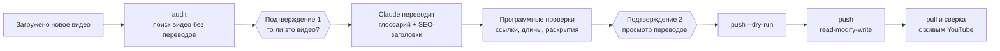

# youtube-localization

**Залил видео, сказал одну фразу — названия и описания готовы на 90 локалях.**

Рабочая система локализации метаданных YouTube для парка каналов, собранная и
эксплуатируемая вместе с [Claude Code](https://claude.com/claude-code). Переводит Claude
в интерактивной сессии; небольшой скрипт на Python носит текст в YouTube Data API и
обратно и не даёт сделать ничего опасного.

[English version](README.md)

| | |
|---|---|
| Каналов | 8, около 850 тысяч подписчиков суммарно |
| Локализовано видео | 1 170 |
| Записано локализаций | 71 275 |
| Кодов локалей на видео | до 90 (66 из них реально видит зритель) |
| Цена одного видео в API | 51 юнит квоты, от числа локалей не зависит |

Каналы в этом репозитории обезличены: alias, handle, ID и владельческие аккаунты
заменены условными. Всё остальное — настоящий рабочий материал.

## Как это устроено



Две части, намеренно разведённые:

- **[`localize.py`](localize.py) — чистый транспорт.** Читает оригиналы (`pull`), ищет
  непереведённые видео (`audit`), заливает готовые переводы (`push`). Сам не переводит и
  не обращается ни к каким AI-сервисам.
- **[`CLAUDE.md`](CLAUDE.md) — рабочая инструкция**, которую Claude читает в начале
  каждой сессии: порядок действий, правила перевода, проверки качества и все найденные
  по дороге особенности API. Это самый интересный файл в репозитории.

Вспомогательные материалы:

- [`glossary.md`](glossary.md) — около 220 терминов шитья и квилтинга на 10 языках,
  единый источник правды, чтобы один термин не переводился тремя способами в трёх видео.
- [`reference/languages-90.md`](reference/languages-90.md) — все 90 кодов локалей: какие
  достижимы для зрителя и чем заполняется каждый.
- [`reference/amazon-disclosure-format.md`](reference/amazon-disclosure-format.md) —
  формулировки партнёрского раскрытия по страновым программам и где оно должно стоять.

## Предохранители

В парке каналов с почти одинаковыми названиями одна ошибка стоит дорого: выбрал не тот
аккаунт при OAuth — и перезаписал чужие метаданные. Скрипт построен вокруг этого риска.

- **Привязка канала.** `link` вписывает `channel_id` в конфиг после экрана подтверждения
  с названием, handle и числом подписчиков. Каждая следующая операция сверяет канал
  токена с этим ID и останавливается при несовпадении до любых изменений.
- **Read-modify-write.** `push` сначала заново читает живое видео и доливает, поэтому
  локали, которых нет в файле, остаются на месте.
- **Один токен на канал.** Токен одного канала не даёт доступа к остальным.
- **Запрещённые и неподдерживаемые локали** отсекаются до вызова API: один отклонённый
  код роняет весь запрос.
- **Сначала dry-run**, реальная заливка — только после явного подтверждения.
- **Общий счётчик квоты.** 10 000 юнитов в сутки принадлежат проекту Google Cloud, а не
  каналу, поэтому скрипт считает расход по всему парку.

## Чего нет в документации

Найдено экспериментами на живых каналах; подробности и даты — в [`CLAUDE.md`](CLAUDE.md).

- `localizations[defaultLanguage]` — зеркало `snippet`. Запись проходит без ошибки и
  молча откатывается. Исправить то, что видит англоязычный зритель, можно только правкой
  оригинала.
- Если выставить `defaultLanguage` в `en-US`, обычный `en` становится полноценной
  записываемой локалью.
- Региональный код, которого нет среди интерфейсов YouTube (`de-AT`, `fr-CH`, `en-CA`),
  записать можно, в Studio он выглядит заполненным, но зрителю его не покажут никогда.
- `videos.update` отвергает часть правдоподобных кодов (`it-IT`, `ja-JP`, `ko-KR`) с
  HTTP 400 и роняет весь батч.
- Все локали уходят одним вызовом `videos.update`, поэтому 90 локалей стоят те же
  51 юнит, что и 23. Ограничитель — объём перевода, а не API.
- Описания часто повторяются между видео. Сначала посчитайте хэши: однажды десять видео
  свелись к пяти шаблонам и были сделаны за один проход.

## Настройка

1. Создайте проект в Google Cloud и включите **YouTube Data API v3**.
2. Настройте OAuth consent screen со scope
   `https://www.googleapis.com/auth/youtube.force-ssl`. Пока приложение в статусе
   Testing, добавьте свой аккаунт в Test users.
3. Создайте OAuth client ID типа **Desktop app** и положите JSON рядом с `localize.py`
   под именем `client_secret.json`.
4. Скопируйте `channels/_example/` в `channels/<alias>/` и впишите `target_languages`.
5. Установите зависимости:
   ```bash
   python -m venv .venv
   source .venv/bin/activate        # Windows: .venv\Scripts\activate
   pip install -r requirements.txt
   ```
6. Привяжите alias к каналу. Откройте браузер в режиме инкогнито, чтобы OAuth не
   подхватил другой аккаунт:
   ```bash
   python localize.py link --channel <alias>
   ```

`client_secret.json`, `token.json`, папки настоящих каналов и каталог `work/` исключены
из git. Так и должно оставаться.

## Команды

```bash
# найти видео, которым не хватает хотя бы одного языка, и выгрузить оригиналы
python localize.py audit --channel <alias> --since today --missing --pull

# выгрузить оригиналы по ID
python localize.py pull --channel <alias> --videos <id1,id2,id3>

# показать, что изменится, без записи
python localize.py push --channel <alias> --file work/<дата>/translated.json --dry-run

# залить в живой канал
python localize.py push --channel <alias> --file work/<дата>/translated.json
```

Формат `translated.json`:

```json
[
  {
    "video_id": "XXXXXXXXXXX",
    "localizations": {
      "de": { "title": "...", "description": "..." },
      "es": { "title": "...", "description": "..." }
    }
  }
]
```

Квота: любой вызов `*.list` стоит 1 юнит, `videos.update` — 50. Одно залитое видео —
51 юнит, то есть потолок около 196 видео в сутки на весь проект.

## Чего здесь нет

- Рабочих файлов сессий: выгруженных оригиналов, готовых батчей и модулей-генераторов,
  которые собирают 90 локалей из общего товарного каталога. `languages-90.md` ссылается
  на них в `work/`; они привязаны к конкретным каналам и остаются приватными.
- Конфигов каналов, истории заливок и ключей доступа.
